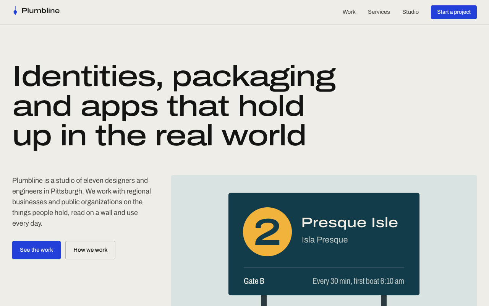

# Plumbline: Next.js agency website template

A static website for a creative or digital agency, with case studies, services, process, team, clients and a project brief form.



[](https://console.cloudzyro.com/new?repo=https://github.com/Cloudzyro/template-agency)

## What's included

- Home page with positioning, a featured project, selected work, services, process, clients, a team teaser and a call to send a brief
- A work index and a page for every case study, generated from one data file: the challenge, the approach in steps, deliverables, results (clearly marked as sample figures), a client quote, credits and a link to the next project
- Services page with what each discipline includes and which case studies show it, the project process and ways to work together
- Studio page with how the studio works, the team and a client list
- Contact page with a project brief form (services, budget, timeline) that posts to a form service of your choice, or opens the visitor's email app when none is set
- Project images drawn in SVG as the real deliverables (a dock sign, a coffee bag, an app screen, a poster, a shop bag, a web page), so there are no photos to license
- Metadata and Open Graph tags per page, sitemap, robots.txt, favicon and social preview image
- Responsive down to 360px, keyboard friendly with visible focus, reduced motion respected

## Run it locally

```bash
pnpm install
pnpm dev        # http://localhost:3000
pnpm build      # static site in out/
```

## Make it yours

- **Studio details and home page text:** `data/site.ts` holds the name, tagline, contact details, menu, the home page copy and the options on the brief form.
- **Case studies:** `data/work.ts` holds every project. Pages, the sitemap and the home page update by themselves. `home.heroProject` in `data/site.ts` picks the project next to the headline. All clients in the template are fictional, and the results are sample figures, so replace them with your own.
- **Services, process, team and clients:** `data/studio.ts`.
- **Project images:** `components/WorkArt.tsx` draws each project. To use photos instead, put them in `public/` and swap the `<WorkArt>` tags for `` tags with alt text.
- **Brief form:** set `NEXT_PUBLIC_FORM_ENDPOINT` to a form endpoint from Formspree, Basin, a Supabase function or similar. The form sends `name`, `email`, `organization`, `website`, `services`, `budget`, `timeline` and `message` as form data. With no endpoint set, the form shows a short note and opens the visitor's email app with the answers filled in, addressed to the email in `data/site.ts`.
- **Site address:** set `NEXT_PUBLIC_SITE_URL` (for example `https://www.yourstudio.com`) so the sitemap, canonical links and social previews use your domain.
- **Colors and fonts:** colors are CSS variables in the `@theme` block at the top of `app/globals.css`. The font is Archivo (self-hosted with Fontsource), used expanded for headlines and condensed for small details.
- **Social preview image:** replace `public/og.png` (1200 x 630).

Environment variables are read at build time. Locally, put them in `.env.local`:

```bash
NEXT_PUBLIC_FORM_ENDPOINT=https://formspree.io/f/your-id
NEXT_PUBLIC_SITE_URL=https://www.yourstudio.com
```

## Deploy

Click the Deploy button above, or push your own copy to GitHub and connect it in the Cloudzyro console. Add the environment variables in your site's settings. The build command is `pnpm build` and the output folder is `out/`, a plain static site.

## Stack

- Next.js 16 with static export (`output: "export"`)
- React 19
- Tailwind CSS 4
- TypeScript
- Archivo variable font via Fontsource

MIT licensed. See [LICENSE](./LICENSE).
